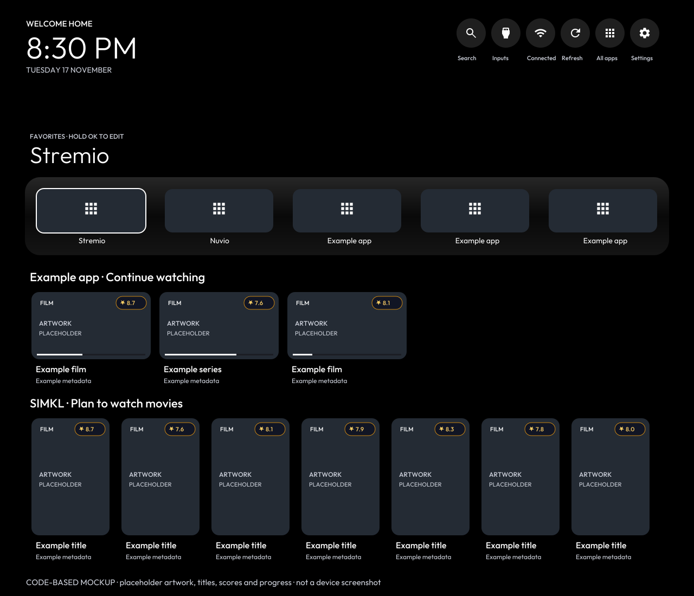

  

<h1 align="center">Matrix Launcher</h1>

An Android Home launcher with an Apple-style layout for Google TV, Android TV, and Fire TV.

  
  
  

  <a href="#installation">Download</a> · <a href="#getting-started">Setup</a> · <a href="#use-it-as-your-home-screen">Home screen</a> · <a href="#features">Features</a> · <a href="#faq">FAQ</a> · <a href="#report-a-bug">Report a bug</a> · <a href="#support">Support</a>

## Installation

**Requires Android 8.0, API 26 or newer.** Fire TV must run a compatible Android-based Fire OS; installation, Home selection, speech recognition and published channels depend on firmware. API 24 is not currently supported. See the [minSdk assessment](openspec/changes/matrix-public-launch/MINSDK.md).

Matrix ships **one universal APK**, with no separate CPU-specific downloads.

| Device | APK |
| --- | --- |
| Google TV | Universal release APK |
| Android TV | Same universal release APK |
| Compatible Android-based Fire TV | Same universal release APK |

This source targets **2.7.6** on the stable channel (versionCode **155**).

1. Open the [latest release](https://github.com/bitmere/matrix-launcher/releases/latest) and download its optimized signed APK. The SHA-256 is in the release notes.
2. Transfer the APK to your TV, open it with an installer/file manager, and allow installation from that source when Android asks.
3. Install and open **Matrix Launcher**. Installation alone does not change your Home app or enable accessibility services.

Use **Settings → About → Check for updates** to read the latest stable GitHub Release, view its notes and download the APK. Matrix checks the published size and SHA-256 before asking Android to install it.

The installed package is `com.matrix.launcher`. The first bitmere-signed build requires a manual clean installation. Earlier installations keep their settings in their own app sandbox. See the [installation guide](docs/NEW-TV-INSTALL.md) for ADB instructions.

## Getting started

1. Open **All apps**, or use **Edit favorites** to choose your dock apps. Hold OK on an app to open its options, app information or uninstall confirmation.
2. In **Settings → Home channels**, select source apps and grant TV-listings access if requested. Enable channel publishing inside those apps where available.
3. Choose row visibility/order, cards per app and **Appearance → Card size**. To reorder, press OK to pick an item, move with Up/Down and press OK to commit; Back cancels an active move.
4. Try **Search → Catalog**. Cinemeta movie/series search works without a key. SIMKL, TMDB and AI Discovery are optional under **Settings → Integrations**.
5. In **Integrations**, choose the installed media app used for catalog titles. Install compatible Stremio or Nuvio separately.
6. Adjust **Appearance**, import wallpaper pictures, or enable the idle clock. Set up Home only when you want Matrix to handle the Home button.

## Use it as your Home screen

Matrix registers as an Android Home app. When the system selects it as Home, the Home button returns to Matrix. Pressing Home again resets Matrix to its top position; returning from an external app preserves your place.

Open **Settings → Home & remote → Choose default Home** and select Matrix in the system picker. Some firmware keeps its own launcher selected. The optional **Home redirect options** offer window-only redirect or accessibility Home-key capture; follow the page’s instructions and enable **Matrix Launcher · Home control** in Android Accessibility. Keep only the helper you intend to use selected. Installing Matrix does not authorize a takeover.

Startup recovery is optional and needs an explicit `WRITE_SECURE_SETTINGS` grant; some vendors also require auto-start access. Controller passthrough can pause key filtering while a controller is connected. Home-key capture can reduce held-volume repeats on some TCL firmware. See [Home setup and rollback](docs/HOME-SETUP.md).

To switch back, choose **Stop Matrix redirect** if enabled, disable Matrix’s Home control accessibility service, and select your previous launcher in Android’s Home settings. Turn off Matrix startup recovery if used. Keep the stock launcher installed so it remains available.

## Features

The [60-item code audit](openspec/changes/matrix-public-launch/FEATURES.md) gives the screen and source file for every feature, including services/providers and supporting app/core policies. The list below describes implemented behavior; external accounts, providers and device integrations have not been certified by this documentation pass.

### Home, apps and channels

- A scrolling favorite dock with app artwork, selection, reordering, long-press options, app information and system-confirmed uninstall.
- Header clock/date, optional Search, TV Inputs, Wi-Fi/Ethernet status, network settings, refresh, All apps and Settings.
- App-published preview channels and Watch Next with progress indicators, stale/duplicate filtering and Nuvio’s published continue-watching queue handling. Availability depends on the source app and TV provider.
- Source selection, row/card order and visibility, per-app preview limits, portrait/landscape artwork and adjustable card sizes. Rows can be reordered and shown or hidden (OK moves a row, hold OK shows or hides it); favorites can be reordered; previews are limited to **4, 8 or 12 cards per row**.
- Retained D-pad row/card focus and scroll position, Back navigation, guarded long presses, and shared TV Material settings and icon controls.
- TV input selection and firmware-aware system settings shortcuts.

### Search and discovery

- Installed-app search and keyless **Cinemeta Catalog** search for movies and series, including posters, metadata and available IMDb scores.
- Search results open in your selected media app — pick a poster and it opens in **Nuvio or Stremio** (1-click, no extra steps). SIMKL, Catalog, TMDB and AI titles all use the same handoff.
- Optional **SIMKL** authenticated search and **TMDB** movie/TV search. TMDB needs your own API key or bearer credential; SIMKL uses the connected account.
- Provider selection, cached results, explicit refresh/cancel, recent searches with a clear action, and voice entry through Android speech services where available. Voice search needs a compatible microphone/service and permission.
- Poster score pills extracted from available **IMDb, TMDB or SIMKL** metadata. A missing score can produce an **UPCOMING** pill from metadata/year; this is not a verified release calendar.
- **AI Discovery** accepts natural-language requests, produces recommendations/reasons and a summary, resolves catalog posters/identities, and filters explicit release years. Suggestions draw on trending metadata/web snippets with offline fallback prompts.
- Provider adapters for **DeepSeek, Gemini, OpenAI, Groq, OpenRouter, Neuralwatt, Perplexity**, and a **custom OpenAI-compatible endpoint**. Configure your key, model/custom model ID, result count and optional web grounding; connection tests and key removal are available. Model/service availability and fees belong to each provider.
- In-process MCP tools: `web_search`, `tv_context`, and `lookup_stream_availability`, with bounded provider tool loops and web-search fallback. These run inside Matrix; there is no external MCP-server configuration screen. The availability tool checks Cinemeta catalog identity, not actual streams or subscription rights. AI results can be wrong.

### SIMKL and opening titles

- **SIMKL integration** — connect your account for lists, library and search; anything you pick opens in **Nuvio or Stremio**. The title-opening app applies immediately to SIMKL and Search.
- Phone QR/device-code approval using your public SIMKL AUTH V2 TV/device Client ID, without entering a SIMKL password or reading another app’s account.
- Selectable movie, TV and anime library rows for watching, planned, on-hold and completed sections supported by the library UI.
- User/followed/collaborative custom lists and public list ID entry open as a card grid, 24 titles per page with a **Next page** button (Page N header, Page one to go back), plus up to four pinned custom-list previews on Home.
- Cached previews, quota-aware activity/delta refresh and eligible offline fallback. Local usage status, live connection test and disconnect/revoke controls are included.
- One-click handoff of SIMKL, Catalog, TMDB and AI titles to compatible installed **Stremio or Nuvio**, with automatic or explicit app selection and supported IMDb identity conversion. Native channel cards return to their publishing app.

Matrix does not contain a video player. Nuvio receives stream-mode requests; Stremio receives detail links with autoplay disabled. Opening a title does not guarantee immediate playback or an available stream. Configure playback inside the target app.

### Appearance and wallpapers

- Shared Matrix colors, Outfit typography, rounded geometry and artwork-derived ambient color, with validated theme-token editing, JSON import/export and reset.
- Remote-friendly local picture browsing/import, a saved-wallpaper chooser, and **Matrix wallpaper** as an image Open with/Share target, including multiple images.
- Optional Wikimedia Commons landscapes, manual or opt-in daily visible-launcher downloads, saved creator/license credits and source QR links. No wallpaper API key is needed.
- Imported/Commons/both/ambient source choices and offline rotation at 15, 30, 60 or 120 minutes (default 30). New collections allow 20 imports and 20 Commons images; [wallpaper guide](docs/WALLPAPERS.md).
- Optional idle clock and Android clock screensaver. Low-RAM devices use cheaper Home effects with wallpaper and animated focus effects disabled.

### Device tools, updates and recovery

- Optional default Home, accessibility redirect/capture, controller passthrough, configured remote app/Input/Settings mappings, quick settings and opt-in startup recovery.
- Permission-gated configuration and selected-service revival adapters for supported firmware. These need Android approvals; they do not bypass platform restrictions.
- **AOT Performance Manager** shows Stremio/Nuvio compilation status and requests ART `speed` compilation using local ADB at `127.0.0.1:5555`. Package-add/update broadcasts also attempt recompilation. An enabled, reachable and authorized debugging daemon is required; compilation consumes time/disk and does not guarantee higher FPS.
- Manual GitHub Releases updater with download progress/cancellation, SHA-256 verification, unknown-source guidance, installation confirmation and pending-session recovery.
- JSON backup export/import for portable settings and optional theme. API keys, tokens/passwords/secrets and device-specific state are excluded; wallpaper image files are not bundled. Reconnect integrations after moving to another TV.
- Manual/per-launch safe mode and automatic fallback after three failed pre-composition starts: default theme/layout, favorites/app channels, with wallpaper, AI and custom SIMKL rows disabled.
- Release notes, data-source credits and bundled software/font/icon licenses under About.

### Home preview

*Code-based mockup, not a device screenshot. Placeholder artwork, titles, scores and progress illustrate the layout; they are not live catalog results.*

The [hero](docs/images/matrix-hero.png) and [Home mockup](docs/images/matrix-home-mockup.png) are generated from Matrix’s theme/layout tokens, Outfit font and existing vector art. [Image sources and reproduction](docs/images/README.md).

## FAQ

**Does this work without accounts or API keys?** Yes. Apps, favorites and app-published channels do not require a Matrix account. Cinemeta Catalog search is keyless. SIMKL, TMDB, AI and Commons downloads are optional; online searches still need network access.

**Why are channels missing?** Select source apps and allow TV listings. Matrix can read only what apps publish and Android exposes. Reloading cannot force Nuvio or another app to synchronize a profile or publish extra rows. Fire TV/provider support varies.

**Will it replace my launcher automatically?** No. Choose Home or explicitly enable a helper. See [Home setup](#use-it-as-your-home-screen) to switch back.

**Does one click always start a video?** No. Matrix hands the title to the target app; its version, configured sources, title mapping and playback setup determine the result. Stremio links open details with autoplay disabled.

**Can I run it on Android 7?** Not this build. The current minimum is Android 8.0 / API 26. Lowering it needs compatibility work, including a strategy for missing Android O channels; see [MINSDK.md](openspec/changes/matrix-public-launch/MINSDK.md).

**Are the images screenshots or performance evidence?** No. They are labeled code-based mockups. This pass provides no device, live-account or performance validation.

**What is backed up?** Portable settings and the optional theme JSON, excluding secrets and device-specific configuration. Wallpaper files and other apps’ accounts are not included.

## Report a bug

[Open an issue](https://github.com/bitmere/matrix-launcher/issues/new) with the Matrix version/versionCode, TV model, Android/Fire OS version, steps to reproduce and expected/actual result. For channel or playback issues, include the source/target app and version. For Home issues, say whether default Home, window redirect or key capture is active. Keep API keys, tokens and account/device dumps out of public reports.

## Support

Use [GitHub issues](https://github.com/bitmere/matrix-launcher/issues) for help and reproducible bugs. Share device compatibility findings or contribute focused fixes/documentation. There is no donation link configured here.

Developers: [documentation index](docs/README.md), [architecture](docs/ARCHITECTURE.md), [testing](docs/TESTING.md), [tooling](tools/README.md), [AI index](llms.txt) and [source provenance](docs/PROVENANCE.md). The Android-free `core` module contains reusable policies; `app` contains Android adapters and Compose screens. Release builds use R8/resource shrinking; signing and publication remain in the existing GitHub Actions workflow. No release is created by these documentation changes.

Licensed under [MIT](LICENSE), with preserved upstream credits. See [third-party notices](THIRD_PARTY_NOTICES.md) for the Outfit font license and Fluent Emoji icon attribution. Third-party service names do not imply endorsement.
